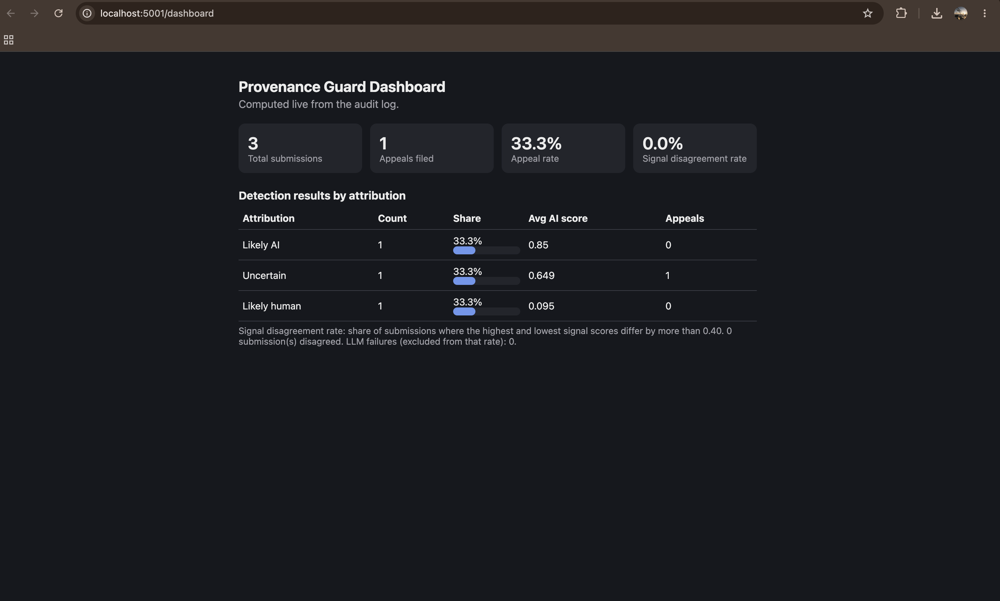

# Provenance Guard

A backend API that a creative-sharing platform could plug into to classify submitted text as likely AI-generated, likely human-written, or uncertain. It returns a confidence score, a plain-language transparency label, and lets creators appeal a classification. Every decision and appeal is written to a structured audit log. Two stretch features are included: a three-signal ensemble and an analytics dashboard.

`planning.md` was written before any implementation code, and it was updated before each stretch feature was built. It holds the full spec, the architecture diagram, and the AI tool plan.

## Setup

```bash
python -m venv .venv
source .venv/bin/activate
pip install -r requirements.txt
```

Create a `.env` file (never commit it):

```
GROQ_API_KEY=your_key_here
```

Optional: set `GROQ_MODEL` in `.env` to override the default model (`openai/gpt-oss-20b`).

Run the server (port 5001, because macOS uses port 5000 for AirPlay):

```bash
python app.py
```

Run the scoring tests:

```bash
python test_scoring.py
```

An older `audit_log.db` is migrated automatically (a `pattern_score` column is added if missing).

### Endpoints

| Endpoint | Purpose |
|---|---|
| `POST /submit` | Classify text. Body: `{"text": "...", "creator_id": "..."}`. Text must be at least 10 words. |
| `POST /appeal` | Contest a classification. Body: `{"content_id": "...", "creator_id": "...", "creator_reasoning": "..."}` |
| `GET /log` | Recent audit log entries as JSON (optional `?limit=N`). |
| `GET /analytics` | Detection and appeal statistics as JSON (stretch feature). |
| `GET /dashboard` | Simple HTML dashboard that reads `/analytics` (stretch feature). |

---

## 1. Architecture overview

When someone submits text, the API first checks the request and applies the rate limit. The same raw text then goes independently to three detection signals: an LLM judgment through Groq, a set of stylometric heuristics, and a pattern and vocabulary signal, both in pure Python. The scorer blends the three scores with a weighted average, applies a disagreement penalty and an agreement guard, and maps the result to one of three attributions and a matching transparency label. The full decision is written to the audit log before the response is returned.

When a creator appeals, the API finds the original submission, checks that the creator ID matches, and changes the status to `under_review`. It records the appeal next to the original decision without overwriting the original scores.

```
SUBMIT:  Client -> Rate limiter -> Validation
         -> [Signal 1: Groq LLM] + [Signal 2: Stylometrics] + [Signal 3: Pattern]
         -> Confidence scorer (weighted ensemble) -> Label generator -> Audit log -> Response
APPEAL:  Client -> Validation + lookup -> Status = under_review -> Audit log (appeal event) -> Response
```

The full diagram is in `planning.md` under `## Architecture`.

---

## 2. Detection signals

I use three signals that look at different things. The LLM reads the text as a whole. The stylometrics measure sentence structure, punctuation, and stock phrases. The pattern signal measures how sentences start and how sophisticated the vocabulary is. Every signal returns a score from 0 (human-like) to 1 (AI-like).

The project started with two signals (the LLM and the stylometrics, as required). The third was added as a stretch feature (see section 9).

### Signal 1: LLM judgment (Groq)

- **What it measures:** the overall feel of the writing: generic phrasing, balanced or cautious tone, lack of specific personal detail, smooth transitions, repetitive structure.
- **Why I chose it:** AI text tends to be polished and predictable. Human writing tends to include specific detail, tangents, and changes in tone. An LLM can weigh these together, which a simple statistic cannot.
- **Model:** `openai/gpt-oss-20b` via Groq at temperature 0. The prompt asks for JSON only: an `ai_probability` and a one-sentence reason. The reason is stored in the audit log.
- **What it misses:** polished or formal human writing looks AI-like to it. Careful writing by non-native English speakers can be flagged. It is also inconsistent: the same AI-style text scored 0.8 in one run and 0.65 in another at temperature 0. Lightly edited AI text with a few personal details can fool it.
- **Failure behavior:** if the API call fails or the output cannot be parsed, the signal returns nothing and the result is forced to `uncertain`.

### Signal 2: Stylometric heuristics

Three metrics, each normalized to 0 to 1 (1 = AI-like) and averaged with equal weight:

| Metric | What it measures | Normalization |
|---|---|---|
| Sentence length variation | Coefficient of variation of sentence lengths. AI sentences tend to be uniform. | CV >= 0.70 gives 0.0, CV <= 0.25 gives 1.0 |
| Informality and punctuation | Markers per 100 words: `!`, `?`, `(`, ellipses, dashes, lowercase sentence starts, ALL-CAPS words of 3 or more letters | 0 per 100 gives 1.0, 4 or more per 100 gives 0.0 |
| Formulaic phrase density | Stock AI phrases per 100 words ("it is important to note", "furthermore", "paradigm", "stakeholders", and so on) | 0 per 100 gives 0.0, 3 or more per 100 gives 1.0 |

- **Why I chose it:** it is independent of the LLM. It cannot be talked into a verdict by fluent-sounding text, and it is deterministic and free.
- **Why not type-token ratio:** it depends heavily on text length and would add noise on short creative pieces.
- **What it misses:** repetitive poetry with uniform lines, formal academic or legal prose, and very short texts all look AI-like to these metrics. The phrase list is easy to evade and will go stale as models change.

### Signal 3: Pattern and vocabulary (stretch)

Two metrics, normalized to 0 to 1 and averaged:

| Metric | What it measures | Normalization |
|---|---|---|
| Sentence opener repetition | Share of sentences that start with a word an earlier sentence already started with. Needs at least 3 sentences, otherwise neutral 0.5. | 0 percent gives 0.0, 50 percent or more gives 1.0 |
| Long-word rate | Words with 9 or more letters per 100 words | 4 or fewer gives 0.0, 12 or more gives 1.0 |

- **Why I chose it:** AI prose tends to repeat openers like "The", "It", and "Furthermore" and to lean on long abstract words. It looks at different features than signals 1 and 2.
- **What it misses:** formal human writing uses long words too, and poems with deliberate repetition have high opener repetition. See the findings in section 9.

---

## 3. Confidence scoring

### Method

With `llm`, `stylo`, and `pattern` as the three signal scores:

1. **Weighted blend.** Texts of 40 words or more: `ai_score = 0.50 * llm + 0.30 * stylo + 0.20 * pattern`. Texts under 40 words: `0.70 * llm + 0.20 * stylo + 0.10 * pattern`, because the statistics are less reliable on short text.
2. **Disagreement penalty.** If the highest and lowest signal differ by more than 0.50, the score is pulled halfway toward 0.5.
3. **LLM failure.** Forced to 0.5 and `uncertain`.
4. **Agreement guard.** `likely_ai` requires `ai_score >= 0.80` and `llm >= 0.60` and `stylo >= 0.60` and `pattern >= 0.50`. Otherwise the result is downgraded to `uncertain`. The pattern threshold is lower because it is the weakest signal.

| `ai_score` | Attribution |
|---|---|
| >= 0.80 (and guard passes) | `likely_ai` |
| 0.36 to 0.79 | `uncertain` |
| <= 0.35 | `likely_human` |

I decided what 0.5 means before writing any math: **0.5 means the system cannot tell.** It is not a weak AI verdict. Because a false positive (calling a human's work AI) is worse than a false negative, the thresholds are asymmetric: the AI label needs a score 0.30 above the midpoint, while the human label needs only 0.15 below it. The AI label also needs every signal to clear its own bar.

The `confidence` field expresses how strongly the result supports the attribution. For `likely_ai` it is `ai_score`. For `likely_human` it is `1 - ai_score`. For `uncertain` it is `1 - 2 * abs(ai_score - 0.5)`, which measures closeness to the midpoint. That means an uncertain result near 0.5 shows a high `confidence` number, which can look odd. It reflects how mixed the evidence is, not confidence that the content is human or AI.

**These scores are not calibrated probabilities.** A confidence of 0.85 does not mean the system is right 85% of the time. I have not measured that.

### How I tested it

First, `test_scoring.py` runs nine offline unit tests on `score()` with hand-picked inputs: all signals high, all low, wide disagreement, LLM failure, the agreement guard triggered separately by a low stylometric score and by a low pattern score, and the short-text weights. All pass.

Second, it runs six reference texts through all three real signals:

| Input | LLM | Stylo | Pattern | `ai_score` | Confidence | Attribution |
|---|---|---|---|---|---|---|
| Clearly AI | 0.80 | 0.90 | 0.50 | 0.771 | 0.458 | `uncertain` |
| Clearly human | 0.15 | 0.07 | 0.00 | 0.095 | 0.905 | `likely_human` |
| Formal human | 0.60 | 0.66 | 0.75 | 0.649 | 0.702 | `uncertain` |
| Lightly edited AI | 0.40 | 0.35 | 0.50 | 0.401 | 0.802 | `uncertain` |
| Repetitive poem | 0.80 | 0.67 | 0.50 | 0.743 | 0.514 | `uncertain` |
| Very short text | 0.60 | 0.67 | 0.25 | 0.578 | 0.844 | `uncertain` |

The pass criteria from my planning doc were: clear AI above 0.70, clear human below 0.40, at least 0.30 between them, and borderline inputs in the uncertain band. The gap between clearly AI and clearly human was 0.68. The formal human text, the lightly edited AI text, and the repetitive poem (my predicted false-positive case) all stayed out of `likely_ai`.

For comparison, the original two-signal version scored the same short "Clearly AI" text 0.842 (`likely_ai`). The ensemble lowered it to 0.771 because that text has only 3 sentences, so the opener metric had nothing to measure (see section 9). A longer AI-style text still reaches `likely_ai` in the ensemble (see the example below).

### Two example submissions with different confidence

Both come from live `POST /submit` calls on the final three-signal system.

**High confidence (longer AI-style essay text):** llm 0.8, stylo 1.0, pattern 0.75, `ai_score` 0.85, confidence 0.85, attribution `likely_ai`.

**Lower confidence (formal economics prose, written by a person):** llm 0.6, stylo 0.662, pattern 0.75, `ai_score` 0.649, confidence 0.702, attribution `uncertain`. The system leans slightly toward AI but is nowhere near the 0.80 bar, so it declines to give a verdict.

---

## 4. Transparency label

The label changes with the attribution. All three exact texts:

| Variant | Shown when | Exact text |
|---|---|---|
| High-confidence AI | `ai_score >= 0.80` and every signal clears its guard | "Our automated analysis suggests this work was likely created with AI assistance. This is an estimate, not a certainty. If you are the creator and this is wrong, you can appeal and a person will review it." |
| High-confidence human | `ai_score <= 0.35` | "Our automated analysis suggests this work was likely written by a person. This is an estimate, not a guarantee." |
| Uncertain | `0.36 <= ai_score <= 0.79`, or the AI guard blocked the label | "We could not tell whether this work was written by a person or created with AI. Our checks gave mixed or weak results, so no verdict has been applied. If you are the creator, you can request a review." |

**Label check with people:** I showed the three labels (in mixed order, with no scores or explanation) to three people who had not seen the project. For each label I asked what it tells them about the work, how sure they think the system is, and what they would do if it appeared on their post.

- **Uncertain label:** All three read it as the system being unable to decide. One said it was not saying the work is bad or that anything is wrong, which was my main concern. None treated it as a flag against the creator. Two said they would request a review only if the result mattered to them.
- **AI label:** All three understood it as an estimate and not proof. All three said they would appeal if they had written the work themselves, so the appeal wording in the label did its job.
- **Human label:** All three understood the system could still be wrong, and one said it has not verified that a person wrote it. Confidence estimates ranged from moderately to pretty sure. None read it as an official certification. Most would leave the post alone.

**Changes made:** None. Nobody misread the intended meaning of any label, so I kept the wording as written in `planning.md`.

**What I would watch for:** The AI label could still sting a creator who did not use AI, which is why it includes the appeal path. With only three participants this is a small check, not a user study.

---

## 5. Rate limiting

| Endpoint | Limit |
|---|---|
| `POST /submit` | `10 per minute;100 per day` per IP |
| `POST /appeal` | `5 per minute` per IP |

Implemented with Flask-Limiter using `get_remote_address` and in-memory storage (`storage_uri="memory://"`). The configuration is in `app.py`.

**Reasoning:**
- A person submitting their own writing sends a handful of pieces in a session, so 10 per minute is generous for real use but stops a script.
- 100 per day caps an adversary probing the classifier for ways to evade it, and keeps usage within the free Groq tier, since every submission makes an API call.
- Appeals are rarer and cost no API call, so 5 per minute is enough for genuine use and blocks spam.

**Evidence:** 12 rapid requests to `/submit` (the test text is over 10 words so it passes validation and reaches the limiter):

```
200
200
200
200
200
200
200
200
200
200
429
429
```

Notes: in-memory storage resets when the server restarts, and Flask-Limiter counts a request even if the handler later returns a 400. A production system would use a shared store such as Redis.

---

## 6. Audit log

Every submission and appeal is written to a SQLite table (`audit_log.db`) and exposed through `GET /log`. Each row includes the timestamp, content ID, creator ID, attribution, confidence, all three signal scores, the LLM's reasoning, status, and any appeal text. An appeal updates the original row's status and also adds a separate `appeal` event that repeats the original decision, so the original scores are never overwritten.

Sample from `GET /log` on the final system (4 entries, newest first; `text`, `appeal_reasoning`, and `llm_reasoning` are shortened or omitted here for readability):

```json
[
  {
    "id": 4,
    "event_type": "appeal",
    "timestamp": "2026-10-13T23:22:58.919016+00:00",
    "content_id": "b9ed95b6-10b9-47c0-b6e4-d2ac25c10040",
    "creator_id": "test-user-3",
    "attribution": "uncertain",
    "ai_score": 0.649,
    "confidence": 0.702,
    "llm_score": 0.6,
    "stylo_score": 0.662,
    "pattern_score": 0.75,
    "status": "under_review",
    "appeal_reasoning": "I wrote this myself as part of my economics coursework. ...",
    "appeal_timestamp": "2026-10-13T23:22:58.918316+00:00",
    "text": "The relationship between monetary policy and asset price inflation ..."
  },
  {
    "id": 3,
    "event_type": "submission",
    "timestamp": "2026-10-13T23:20:37.856497+00:00",
    "content_id": "b9ed95b6-10b9-47c0-b6e4-d2ac25c10040",
    "creator_id": "test-user-3",
    "attribution": "uncertain",
    "ai_score": 0.649,
    "confidence": 0.702,
    "llm_score": 0.6,
    "stylo_score": 0.662,
    "pattern_score": 0.75,
    "status": "under_review",
    "appeal_reasoning": "I wrote this myself as part of my economics coursework. ...",
    "text": "The relationship between monetary policy and asset price inflation ..."
  },
  {
    "id": 2,
    "event_type": "submission",
    "timestamp": "2026-10-13T23:19:50.879129+00:00",
    "content_id": "567a8036-f8c2-4abf-ae37-82a200fbd1e3",
    "creator_id": "test-user-2",
    "attribution": "likely_human",
    "ai_score": 0.095,
    "confidence": 0.905,
    "llm_score": 0.15,
    "stylo_score": 0.066,
    "pattern_score": 0.0,
    "status": "classified",
    "appeal_reasoning": null,
    "text": "ok so i finally tried that new ramen place downtown ..."
  },
  {
    "id": 1,
    "event_type": "submission",
    "timestamp": "2026-10-13T23:19:06.823442+00:00",
    "content_id": "23696216-55f9-4ad2-970e-7baa0913c38b",
    "creator_id": "test-user-1",
    "attribution": "likely_ai",
    "ai_score": 0.85,
    "confidence": 0.85,
    "llm_score": 0.8,
    "stylo_score": 1.0,
    "pattern_score": 0.75,
    "status": "classified",
    "appeal_reasoning": null,
    "text": "In todays rapidly evolving digital landscape, artificial intelligence ..."
  }
]
```

### Appeals

`POST /appeal` takes a `content_id`, the `creator_id`, and `creator_reasoning`. It returns 400 for missing fields, 404 for an unknown content ID, 403 if the creator ID does not match the original submission, and 409 if the content is already under review. On success it sets the status to `under_review`, stores the reasoning and an appeal timestamp, and adds an `appeal` event to the log. I tested all four error paths and the success path (see the log above). Automated re-classification is not implemented.

---

## 7. Known limitations

- **Repetitive, simple-vocabulary poetry.** A poem built on repeated lines of similar length has very low sentence-length variation and high opener repetition, so two of the three signals read it as AI-like. My repetitive test poem scored 0.80 from the LLM, 0.67 from the stylometrics, and 0.50 from the pattern signal, giving `ai_score` 0.743. The wide uncertain band and the agreement guard kept it from being labeled AI, but it is close enough to the threshold to be a real false-positive risk.
- **Formal academic writing and careful non-native English.** Long, evenly structured sentences with no informal punctuation and many long words push all three signals toward AI at once, so the agreement guard does not help. My formal human test scored 0.649, closer to the AI zone than I would like. This is a real fairness risk for non-native English writers, and it is the main reason the appeal path exists.
- **Short AI-style text.** A 3-sentence AI-style paragraph dropped from `likely_ai` to `uncertain` once the pattern signal was added, because the opener metric needs at least 3 sentences to say anything. Short AI text is more likely to be missed. I accept this because false negatives are the cheaper error.
- **Lightly edited AI text.** A few casual edits raise sentence variation and add informal markers, lowering the stylometric score while the content stays AI-authored. My test case scored 0.401 and was close to being called human.
- **LLM inconsistency.** The same text scored 0.8 and 0.65 on different runs at temperature 0. Near a threshold, the label could change between submissions of identical text.
- **Signals 2 and 3 overlap on formality.** Both react strongly to formal writing, so the three signals are less independent than they look.
- **No authentication.** Appeals are checked only by matching `creator_id`, and `GET /log`, `/analytics`, and `/dashboard` are open.

If I deployed this for real, I would collect labeled human and AI samples to calibrate the scores into real probabilities, run the LLM signal several times and average it, and send the appeal queue to an actual reviewer interface.

---

## 8. Spec reflection

**How the spec helped.** Writing exact weights, thresholds, and normalization ranges in `planning.md` before coding let me unit-test `score()` offline with hand-picked inputs before making any API calls. Having the thresholds written down also gave me something concrete to check generated code against. Deciding what 0.5 means before writing math shaped the asymmetric thresholds and the agreement guard. Planning each stretch feature first, including a test plan with pass criteria, meant I knew what result would count as a problem before I saw the numbers.

**How the implementation diverged.**
- The Groq model in the spec and assignment (Llama 4 Scout) returned a 404 on my account, so I listed available models and switched to `openai/gpt-oss-20b`.
- My test run showed that the ALL-CAPS check counted "AI" as shouting, which pulled a clearly AI text's informality score down and kept it from reaching `likely_ai`. I changed the rule to require 3 or more letters.
- My first spec set a 20-word minimum, which would have made the assignment's own rate-limit test text fail validation. I lowered it to 10 words before building.
- `llm_signal` returns a pair of the score and the reasoning, not just a float, so the reasoning can be logged. The sentence splitter also splits on line breaks so poems are measured line by line, and a single-sentence text gets a neutral 0.5 on that metric.
- For the ensemble, I wrote in the spec that the disagreement limit would be 0.50 (up from 0.40) because three signals naturally spread more. The analytics dashboard uses 0.40, so it reports how often signals differ meaningfully and not only how often the penalty fires.
- After the ensemble tests, I deliberately did not retune the weights to bring the short AI sample back to `likely_ai`, since that would be fitting the system to one test case.

---

## 9. Stretch features

### Stretch 1: Ensemble detection

**What I built.** A third detection signal (pattern and vocabulary, described in section 2) and a documented weighting that combines all three signals.

**How it works.** The three scores are combined by weighted average: 0.50 LLM, 0.30 stylometrics, 0.20 pattern for texts of 40 words or more, and 0.70, 0.20, 0.10 for shorter texts. A disagreement penalty applies when the strongest and weakest signals differ by more than 0.50. The AI label requires all three signals to clear their own thresholds (0.60, 0.60, and 0.50), in addition to the 0.80 combined score. The API response includes `pattern_score` under `signals`, and the audit log stores it.

**Why a weighted average and not voting.** Voting throws away how strong each signal is, and a 2 to 1 vote would let the two statistical signals outvote the LLM on formal human writing. The weights keep the LLM as the strongest signal while still letting the others pull the score.

**What the tests showed.**
- The unit tests and the pass criteria from the plan all held (section 3). The formal human text, lightly edited AI text, and repetitive poem all stayed `uncertain`, so the third signal did not create the false positives I was worried about.
- **Opener repetition needs more text.** On a 3-sentence AI-style paragraph with no repeated openers, the metric gave 0 and the combined score fell from 0.842 (two signals, `likely_ai`) to 0.771 (`uncertain`). A longer AI-style text with 4 sentences and a repeated opener scored 0.85 and kept `likely_ai`.
- **The long-word metric mostly measures formality.** Formal human writing (23 per 100 words) and lightly edited AI (15 per 100) both saturate it at 1.0, while casual human writing scored 1.8. So signal 3 overlaps with signal 2's formality view and is not fully independent. This is why it has the lowest weight.

The ensemble did not clearly improve classification on my reference set. It kept the same behavior and added more caution on short AI text, which is on the safe side of the false-positive asymmetry.

### Stretch 2: Analytics dashboard

**What I built.** `GET /analytics` returns statistics as JSON, and `GET /dashboard` serves a single HTML page that fetches `/analytics` and shows cards and a table (with light and dark mode support). It uses no external libraries.

**Metrics.**
- Total submissions, and the count, percentage, and average `ai_score` for each attribution.
- Total appeals, the appeal rate (appeals divided by submissions), and appeals broken down by the original attribution, which shows which labels creators contest most.
- **Additional metric: signal disagreement rate.** The share of submissions where the highest and lowest signal scores differ by more than 0.40. This shows how often the signals conflict, which is where the system is least trustworthy. Submissions where the LLM failed are excluded and counted separately as `llm_failures`.

**How I tested it.** I tested the empty database first (every value is 0 with no error, and the dashboard shows "No data yet"). Then I submitted three texts and filed one appeal and checked the output against `GET /log` by hand:

```json
{
  "total_submissions": 3,
  "total_appeals": 1,
  "appeal_rate": 0.333,
  "average_ai_score": 0.531,
  "by_attribution": {
    "likely_ai": {"count": 1, "percent": 33.3, "average_ai_score": 0.85},
    "uncertain": {"count": 1, "percent": 33.3, "average_ai_score": 0.649},
    "likely_human": {"count": 1, "percent": 33.3, "average_ai_score": 0.095}
  },
  "appeals_by_attribution": {"likely_ai": 0, "uncertain": 1, "likely_human": 0},
  "signal_disagreement_rate": 0.0,
  "signal_disagreement_count": 0,
  "llm_failures": 0
}
```

The counts match the log: the one appeal is on the formal human text, which was classified `uncertain`. The disagreement rate is 0.0 because the widest gap between signals in any of the three texts was 0.25, so the signals agreed on clear-cut inputs. The metric is designed to rise on borderline text.



---

## 10. AI usage

I used an AI assistant throughout, directing it with my spec.

1. **App code from the spec.** I had the AI generate `app.py` (Flask routes, the Groq signal function, the SQLite audit log) from my `planning.md` sections. What it produced used the Llama 4 Scout model named in the spec, which returned a 404 on my account. I overrode it by listing the models my key could access, switching to `openai/gpt-oss-20b`, and updating `planning.md` to match.
2. **Stylometric and scoring code.** I had it write `stylometric_signal` and `score()` against my thresholds and checked every constant against the spec. Running my reference inputs showed the generated ALL-CAPS rule treated the acronym "AI" as informal shouting. I changed the rule to 3 or more letters and added a unit test for the agreement guard, which the original tests did not exercise.
3. **Spec review.** I had the AI review my `planning.md`. It caught that my 20-word minimum conflicted with the rate-limit test text in the assignment, and I fixed the number in the spec before writing code.
4. **Stretch features.** I had the AI write the third signal, the three-signal `score()`, and the dashboard from the Stretch sections of `planning.md`. I checked the constants against the spec, added a second guard test so each guard condition is exercised separately, and cross-checked the `/analytics` numbers against `/log` by hand. When the ensemble results showed a short AI text dropping to `uncertain`, I decided against retuning the weights to fix one sample and documented it as a finding instead.

---

## 11. Walkthrough video
https://drive.google.com/drive/folders/1FJWp8XB4ePvw5IOZsK8Q5qHXMq0Ysk6X?usp=drive_link
